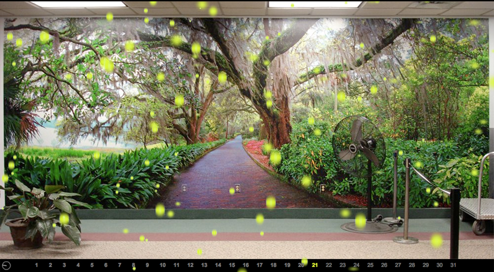

# Anemophilous Formula for Computer Art

Owen Mundy & Joelle Dietrick, 2007. Generative animation and sound.



> Inspired by Jim Campbell's *Formula for Computer Art* and Tallahassee's annual sea of tree pollen, Owen Mundy and Joelle Dietrick created a generative animation referencing new forms of cross-pollination and re-use. Intentionally meditative and aesthetically pleasing, the format parodies computer art that simply crunches numbers to create useless forms. The diligently recorded data of the National Allergy Board guides the animation down a predictable path and stands in stark contrast to the chaos of everyday life. The project calls into question our obsession with mapping nature, as if grasping its sublimity would be essential to finding lifelong satisfaction.

This is a dependency-free vanilla JavaScript rebuild of the original ActionScript 2 / Flash piece.

## Running it

Open `index.html` in a browser. It works straight from the filesystem, but using live server gives a gapless sound loop.


There's no build step. Deploy the folder to any static host as is.

| Key / action | Effect |
| --- | --- |
| Begin, `Enter` or a click | dismiss the title and start the sound |
| `F` or double-click | fullscreen |
| `M` | mute |
| `I` | information: statement, current date, pollen count, grains on screen |

| URL option | Effect |
| --- | --- |
| `?kiosk` | for installations: skip the title, hide the cursor, start sound on the first click or key press |
| `?day=21` | start on a given day of March |
| `?muted` | start with sound off |


<!-- 


## How it works

Each day of March 2007 lasts about four seconds. The day's tree pollen count, divided by 8, sets how many grains may fall. A grain only checks that number when it drifts off the stage and recycles to the top, so density changes gradually rather than all at once. A clock in the corner sweeps once per day, and the current date lights up in the row below. The whole month loops indefinitely over a birdsong recording.

```
index.html          page shell, title and info overlays
css/style.css
js/data.js          the pollen data and every constant from the original
js/grain.js         one pollen grain (a port of SnowFlake.as) + blurred sprite cache
js/main.js          stage scaling, frame loop, day timer, clock, dates, sound, controls
assets/img/wallpaper.jpg       the photographic mural, 3000×1563 (see below)
assets/sound/pollensound.mp3   pollensound_clean.wav, MP3 encoded (VBR ~190 kbps)
```

## Notes on fidelity

The main timeline code was recovered from the UTF-16 ActionScript text stored inside `index_20090913.fla` and ported line for line. Where the original was ambiguous, the 2009 screen recording (`index.mov`) and the documentation images were used as the reference.

- **Stage and timing.** The stage is 1000×550 and is letterboxed to fit any screen. Grain motion runs at a fixed 30 steps per second (the SWF's frame rate) and is interpolated for smooth display on faster screens. The day timer ticks every 100 ms, and a new day starts every 39 ticks, as in `updateTimer()`.
- **Grains.** Speed (1–26 px/frame), drift (±7 px/frame), size (speed × 9% scale) and recycling are taken directly from `SnowFlake.as`. Flash's `BlurFilter(drift*2, speed/2, 2)` is reproduced as a two-pass box blur. As in Flash, a negative horizontal blur is clamped to 0, so grains drifting left fall crisp and grains drifting right smear sideways.
- **At most 251 grains.** The timeline creates 350 grains but hides the container of every grain past index 250, and nothing ever shows those again. That quirk is kept, so busy days cap at 251 grains, just as the original did.
- **Measured values.** The grain symbol's base size (12 px) and the date colour (`#888`, where the code says `0x666666`; Flash rendered it lighter) were measured from the recording. The `fscommand` fullscreen call became the `F` key, and because browsers block sound without a gesture, a title screen comes first.
- **Background photo.** The only clean source is 1000×521 (`wallpaper.psd`; the 3300px documentation PSD is an upscaled screen capture with grains baked in). The lossless PSD was flattened and enlarged 3× with Photoshop's Preserve Details 2.0, so it holds up on large and high-density screens. Its colors match the 2009 JPEG. The page resamples it once to the exact screen size on each resize.
- **Clock.** In the original, `clock_mc` stepped one of 40 frames every 100 ms. Here the hand sweeps continuously at the same rate.
- **Unused.** The `mask` clip, the commented-out triangle markers (`point_mc`) and the `chart` FLA (a bar chart of the same data) aren't part of the running piece and were not ported.

-->


## License

MIT
